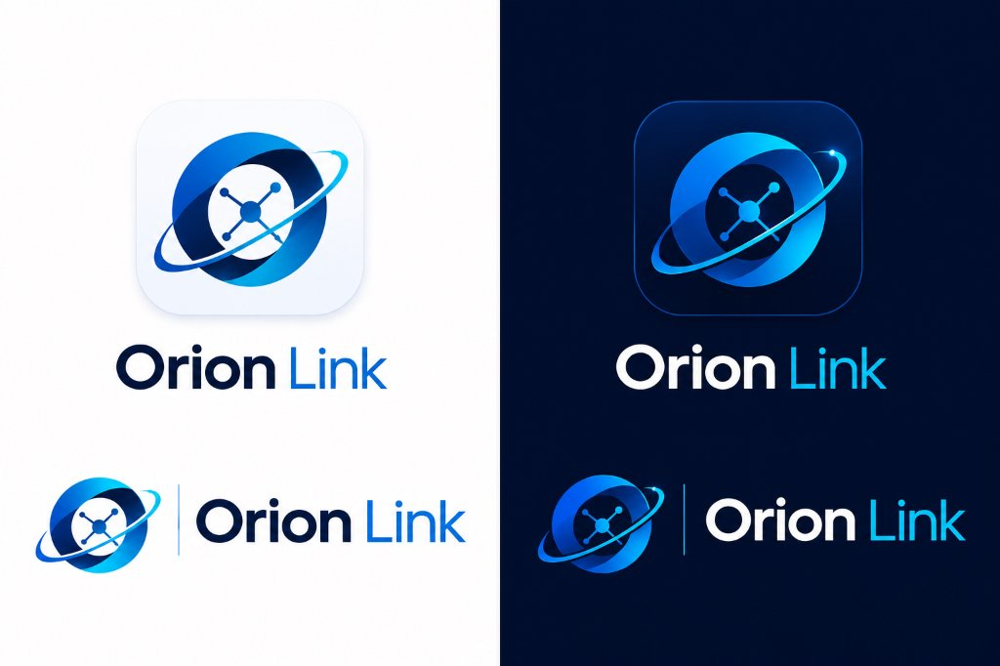

# Orion Link — Frontend (`orion-link-frontend`)

<p align="center">
  
</p>

Interfaz web desacoplada para **Orion Link**, Sistema CRM de Soporte Técnico y Operaciones ISP (FTTH), construida con **HTML5 semántico**, **CSS3 Bitema (Modo Claro / Modo Noche NOC)** y **JavaScript Vanilla modular (ES Modules 100% Orientado a Objetos)**, conectada en tiempo real con `orion-link-backend`.

---

## ¿Qué es en realidad Orion Link y cómo funciona?

**Orion Link** es una plataforma operativa para proveedores de internet por fibra óptica (**ISP / FTTH GPON**) que conecta en tiempo real a las **4 áreas críticas** de una operación de telecomunicaciones:

1. **Planta Externa y NOC (`admin`):** Monitorea cabeceras ópticas (`OLTs`), cajas de distribución en postes (`Cajas NAP` con splitters `1:8` y `1:16`) y terminales ópticas en hogares (`ONUs`), detectando de inmediato cuando un corte de fibra deja sin luz óptica (`LOS`) a un sector entero.
2. **Mesa de Ayuda y Soporte Técnico N1/N2 (`support_agent`):** Recibe los reportes de avería, lanza pruebas remotas de potencia láser (`rx_power_dbm`, latencia, pérdida de paquetes) para resolver problemas de primer nivel sin desplazar vehículos, o escala el ticket a una cuadrilla cuando confirma daño físico en la fibra.
3. **Cuadrillas Técnicas en Campo (`field_tech`):** Reciben su hoja de ruta geolocalizada, marcan su arribo al poste o domicilio (`en_route` → `on_site`) y **certifican la reparación con medidor de potencia óptica** (`-14.00` a `-25.00 dBm`) junto con los metros de cable drop utilizados.
4. **Portal de Autogestión del Cliente Suscriptor (`customer`):** Permite al titular del contrato revisar la salud de su router ONU, ejecutar un autodiagnóstico remoto en un clic, verificar si su zona tiene una falla masiva reportada y dar seguimiento a sus tickets.

---

## Arquitectura Polimórfica de Dashboards por Rol (`js/role-workspaces.js`)

En lugar de mostrar la misma pantalla genérica a todos los usuarios, `orion-link-frontend` implementa el patrón **Strategy Polimórfico Orientado a Objetos** (`RoleWorkspaceStrategy` y sus 4 subclases especializadas), de modo que cada rol recibe un **espacio de trabajo, KPIs, widgets exclusivos y pestañas radicalmente distintos**:

| Rol | Clase Polimórfica OOP | Vista Inicial por Defecto | Pestañas Habilitadas | Widget Exclusivo y Capacidades Únicas del Dashboard |
|---|---|---|---|---|
| **`admin`** | `AdminNocWorkspace` | **Topología FTTH (`panel-topology`)** | 6 pestañas: `Topología FTTH`, `Fallas Masivas`, `Contratos & Diagnóstico`, `Tickets Soporte`, `Despacho Cuadrillas`, `Usuarios & RBAC` | **Radar NOC de Planta Externa:** 6 KPIs ejecutivos de red, formulario para **declarar manualmente Fallas Masivas de Fibra**, aprovisionamiento de nuevas Cajas NAP y **Directorio de Auditoría de Usuarios y Roles RBAC**. |
| **`support_agent`** | `SupportAgentWorkspace` | **Cola de Tickets (`panel-tickets`)** | 4 pestañas: `Cola de Tickets (Triaje)`, `Diagnóstico de Contratos`, `Fallas Masivas Activas`, `Escalamiento a Cuadrillas` | **Protocolo Rápido de Triaje N1/N2:** 4 KPIs de mesa de ayuda (Cola abierta, SLA Crítico/Alto, Diagnósticos ejecutados, Fallas masivas), simulador de telemetría GPON en `dBm`, botón de **Resolución Remota N1 en 1 clic** y despacho a cuadrilla N2. |
| **`field_tech`** | `FieldTechWorkspace` | **Mis Órdenes de Campo (`panel-dispatches`)** | 2 pestañas de campo: `Mis Órdenes de Campo`, `Mapa de Cajas NAP & Postes` | **Hoja de Ruta Activa de Cuadrilla:** 4 KPIs de terreno (Órdenes pendientes, En sitio, Certificadas y Metros de fibra usados), tarjeta destacada con la próxima intervención, botón rápido **`Marcar En Sitio`** y modal de **Certificación Óptica en `dBm`** (`-14.00` a `-25.00 dBm`). |
| **`customer`** | `CustomerPortalWorkspace` | **Mi Fibra & Router ONU (`panel-contracts`)** | 2 pestañas personales: `Mi Fibra & Router ONU`, `Mis Solicitudes de Soporte` | **Resumen de Mi Servicio Instalado:** 4 KPIs personales (Velocidad simétrica contratada, Estado de mi router ONU, Nivel de señal óptica en `dBm` y Cuota mensual), botón de **Autodiagnóstico de Mi Router** (sin controles internos de inyección de `dBm`) y apertura de tickets. |

---

## Seguridad de Sesión y Bloqueo del Botón "Atrás" Post-Logout (`bfcache` Guard)

El frontend implementa una defensa multicapa en `js/api.js`, `js/auth.js` y `js/app.js` para garantizar que, una vez cerrada la sesión, sea imposible volver a visualizar el dashboard presionando el botón **"Atrás"** del navegador:

1. **Revocación Real en Servidor + Limpieza de `localStorage` y `sessionStorage`:** Al cerrar sesión, `DashboardApp` invoca `POST /api/v1/auth/logout` (que revoca el `jti` del JWT en el backend y borra la cookie `HttpOnly`) y ejecuta `ApiClient.clearSession()`.
2. **Navegación con Reemplazo de Historial (`window.location.replace`):** Tanto el login como el logout utilizan `window.location.replace(...)` en lugar de `window.location.href`, evitando que la vista privada quede apilada en el historial de retroceso.
3. **Guardia contra Back-Forward Cache (`pageshow` + `visibilitychange`):** `DashboardApp.installBackButtonGuard()` intercepta el evento `pageshow` (incluyendo restauraciones desde `bfcache` con `event.persisted === true`). Si `ApiClient.hasLocalSessionFlag()` es falso o `GET /auth/me` devuelve `401`, vacía inmediatamente el DOM (`document.body.innerHTML = ''`) y redirige a `auth.html`.

---

## Estructura del Proyecto

```text
orion-link-frontend/
├── assets/
│   └── img/
│       ├── orion-link-brand-sheet.jpg # Lámina oficial de identidad visual bitema (Claro / Noche NOC)
│       └── orion-link-mark.svg        # Isotipo vectorial SVG (anillo orbital 3D + nodo FTTH de 4 puntas)
├── css/
│   └── styles.css                  # Sistema de diseño bitema, tokens CSS de marca y semáforo óptico dBm
├── docs/
│   └── diagrams/                   # Diagramas editoriales HTML/SVG (Arquitectura y Flujo de 4 Roles)
├── js/
│   ├── api.js                      # Clase ApiClient (fetch wrapper no-store, Cookie HttpOnly + Bearer y guardia 401)
│   ├── app.js                      # Clase DashboardApp (orquestador multi-rol y guardia anti-bfcache en botón Atrás)
│   ├── auth.js                     # Clase AuthPageController (login, registro y selector rápido de 4 roles)
│   ├── landing.js                  # Clase LandingController (monitor público de Cajas NAP y planes FTTH)
│   ├── role-workspaces.js          # Jerarquía polimórfica RoleWorkspaceStrategy (4 dashboards especializados por rol)
│   ├── theme.js                    # Clase ThemeManager (Modo Claro / Modo Noche NOC)
│   └── utils.js                    # Clase UIUtils (Escape anti-XSS, Toasts, badges dBm y healthcheck)
├── pages/
│   ├── auth.html                   # Portal de inicio de sesión y registro con DPI
│   └── dashboard.html              # Consola operativa polimórfica según el rol autenticado
├── .gitignore
├── index.html                      # Landing page y monitor público de red FTTH
├── netlify.toml                    # Configuración lista para despliegue en Netlify
└── README.md
```

## Cómo Ejecutarlo

1. Asegúrese de que `orion-link-backend` esté corriendo en `http://localhost:5000/api/v1`.
2. Sirva la carpeta `orion-link-frontend` con cualquier servidor estático local:
   ```bash
   npx serve -l 5500 .
   ```
3. Abra `http://localhost:5500` en su navegador. En `pages/auth.html` dispone de los **4 botones de acceso rápido por rol** (`Admin NOC`, `Soporte N1/N2`, `Técnico Campo`, `Cliente FTTH`) para comprobar cada dashboard especializado.

## Autoría

- **Autor:** Henrik Anderson Oloroso García ([Anderson-Oloroso](https://github.com/Anderson-Oloroso)).
